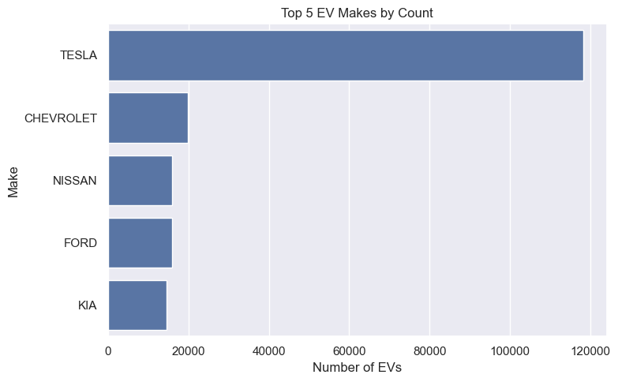
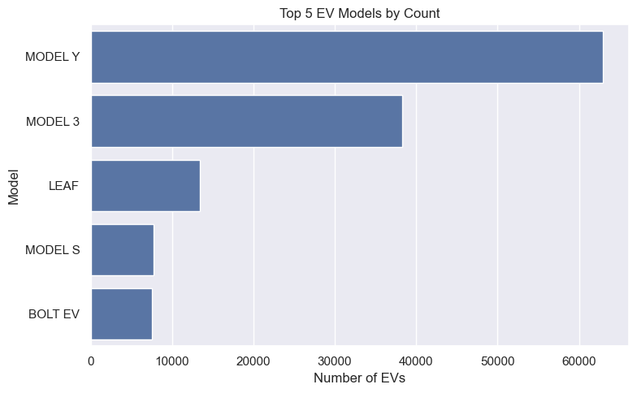
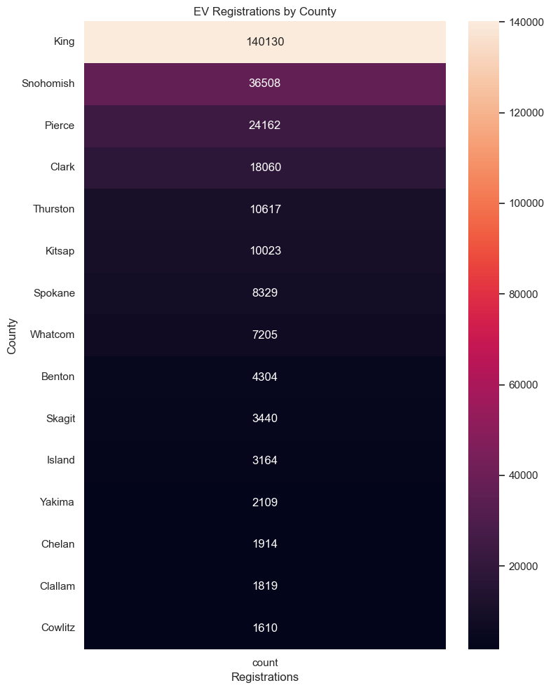
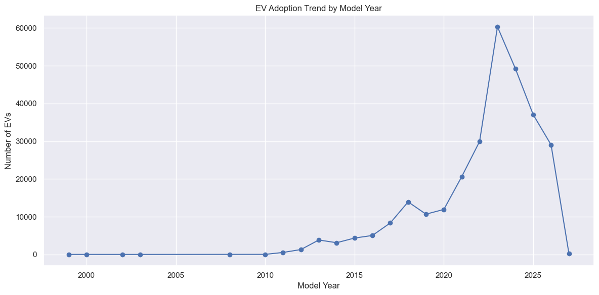
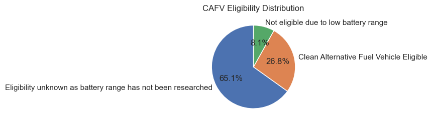
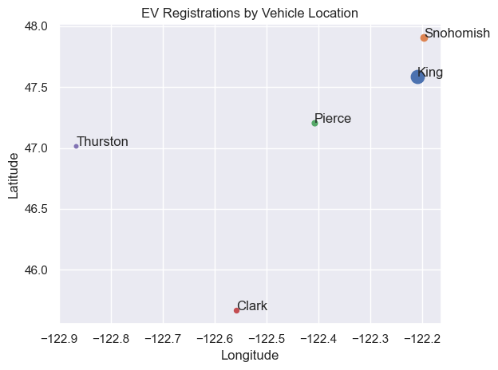

# **Project Type:** Internship Project – GrowAI
# Electric Vehicle Registration Analysis

## Project Overview

Which electric vehicle manufacturers and models are most common, and where are EV registrations concentrated?

This project analyzes **289,564 electric vehicle registration records** to understand manufacturer and model popularity, regional distribution, vehicle model-year patterns, electric range, and CAFV eligibility.

The project was completed as part of my **GrowAI Data Analyst Internship** using Python.

## Business Problem

Understanding EV registration patterns can help businesses explore market presence, identify popular vehicle models, and investigate areas with higher concentrations of electric vehicles.

The analysis focuses on identifying the most common manufacturers and models, counties with higher registration counts, and patterns in vehicle characteristics and CAFV eligibility.

## Project Objectives

- Identify the most commonly registered EV manufacturers and models.
- Analyze EV registrations across counties.
- Examine vehicle counts by model year.
- Explore electric range across vehicle types, makes, and models.
- Understand the distribution of CAFV eligibility categories.
- Examine geographic patterns using vehicle location coordinates.

## My Role

As a GrowAI Data Analyst intern, I cleaned and analyzed the EV registration data using Python, explored registration patterns, and created visualizations to present the key findings.

## Tools & Technologies

- Python
- Pandas
- NumPy
- Matplotlib
- Seaborn
- Jupyter Notebook

## Analysis Workflow

### 1. Data Loading and Understanding

- Imported the dataset into Python using Pandas.
- Examined the dataset structure, dimensions, column names, and data types.
- Reviewed descriptive statistics and checked data quality.

### 2. Data Cleaning

- Checked for missing values and duplicate records.
- Filled missing Electric Range values using the median.
- Filled missing categorical values with `Unknown`.
- Filled missing numeric location fields using their respective median values.
- Created a numeric VIN label using factorization.
- Extracted latitude and longitude from the Vehicle Location field.

### 3. Exploratory Data Analysis

- Identified the most common EV manufacturers and models.
- Analyzed registrations by county.
- Examined vehicle counts by model year.
- Calculated the overall average electric range.
- Compared electric range by vehicle type, make, and model.
- Examined CAFV eligibility categories.

### 4. Data Visualization

Created visualizations to communicate the main patterns:

- Top 5 EV Manufacturers
- Top 5 EV Models
- EV Registrations by County
- EV Distribution by Model Year
- CAFV Eligibility Distribution
- EV Registrations by Vehicle Location

## Key Findings

- **Tesla** had the highest number of registrations, with **118,148**.
- **Chevrolet** ranked second, with **19,808** registrations.
- **Tesla Model Y** was the most common model, with **62,979** registrations.
- **King County** had the highest number of registrations, with **140,130**.
- Model year **2023** had the highest vehicle count, with **60,332** records.
- The calculated average Electric Range was **37.4 miles** across all records, including records with zero range.
- **65.08%** of records had unknown CAFV eligibility, while **26.79%** were eligible and **8.13%** were not eligible.

## Key Visualizations

### Top 5 EV Manufacturers


### Top 5 EV Models


### EV Registrations by County


### EV Distribution by Model Year


### CAFV Eligibility Distribution


### EV Registrations by Vehicle Location


## What I Achieved

- Analyzed 289,564 EV registration records across 16 original columns.
- Identified the leading manufacturers, models, and counties by registration count.
- Explored vehicle distribution by model year and CAFV eligibility.
- Compared electric range across vehicle types, manufacturers, and models.
- Created visualizations to communicate registration patterns and geographic distribution.

## Business Recommendations

- Businesses can use manufacturer and model registration patterns to guide market research and inventory planning.
- The high registration count in King County makes it a useful area to examine when evaluating locations for EV-related services.
- Counties with lower registration counts can be investigated further to understand local vehicle availability and charging infrastructure.
- More complete electric-range and CAFV information would support more reliable comparisons of vehicle characteristics and eligibility.

## Challenges & Solutions

**Handling Missing and Zero Values:** The dataset contained missing values across several columns and a large number of zero values in Electric Range. I handled missing values according to their column types and examined the zero values separately.

**Working with Geographic Information:** Vehicle Location was stored as coordinate text. I extracted latitude and longitude using string operations so the geographic information could be used in further analysis.

## Limitations

- The dataset did not contain Base MSRP, so vehicle price analysis could not be performed.
- A large proportion of Electric Range records contained zero values. Therefore, the overall average of 37.4 miles should not be interpreted as the typical electric range of registered vehicles.
- Median imputation was applied to numeric location identifiers such as Postal Code, Legislative District, and Census Tract. These imputed values may not represent actual locations.
- The model-year analysis shows vehicle counts by model year, not annual registration growth.
- A large proportion of records had unknown CAFV eligibility.

## Future Enhancements

- Improve the treatment of missing location identifiers.
- Use more complete electric-range and CAFV information for more reliable comparisons.
- Combine registration data with charging-station and population data to explore regional EV patterns in greater detail.
- Add vehicle price information to examine the relationship between price and electric range.

## Project Structure

```text
Electric-Vehicle-Analysis/
│
├── Dataset/
│   └── Raw/
│       └── export.csv
│
├── Python/
│   └── Electric_Vehicle_Analysis.ipynb
│
├── Reports/
│   ├── Top_5_EV_Makes.png
│   ├── Top_5_EV_Models.png
│   ├── EV_Distribution_by_County.png
│   ├── EV_Adoption_by_Model_Year.png
│   ├── CAFV_Eligibility.png
│   └── EV_Registrations_by_Vehicle_Location.png
│
├── README.md
├── Requirements.txt
├── Data_Dictionary.md
├── Cleaning_Log.md
└── Business_Insights.md
```

## How to View the Project

Open `Python/Electric_Vehicle_Analysis.ipynb` using Jupyter Notebook to review the data preparation, analysis, and visualizations.

The saved charts are available in the `Reports` folder.

## Conclusion

This project provided an overview of electric vehicle registration patterns in the dataset. It identified the leading manufacturers and models, highlighted King County's high registration count, and explored vehicle model years, electric range, and CAFV eligibility. These findings provide a starting point for further investigation into EV market distribution and regional requirements.